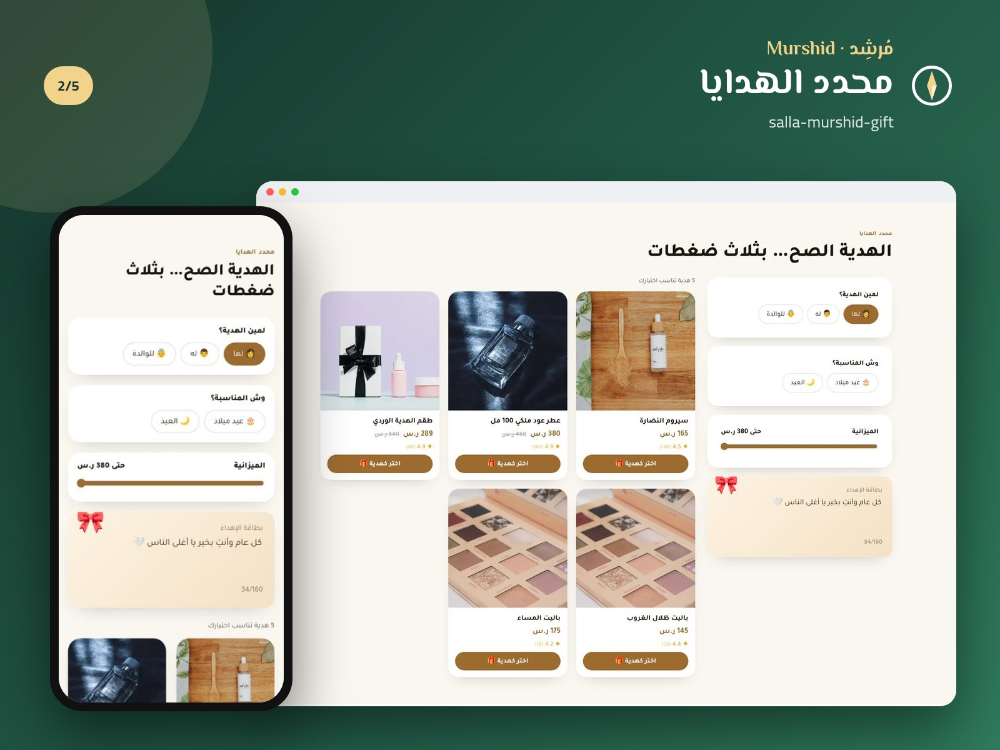
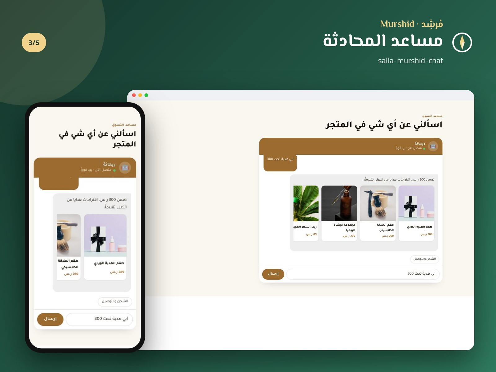
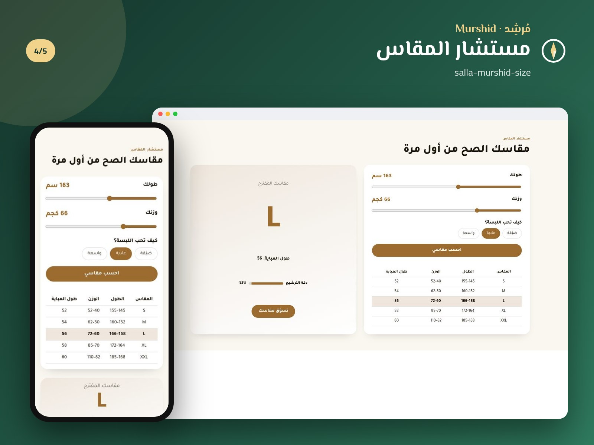
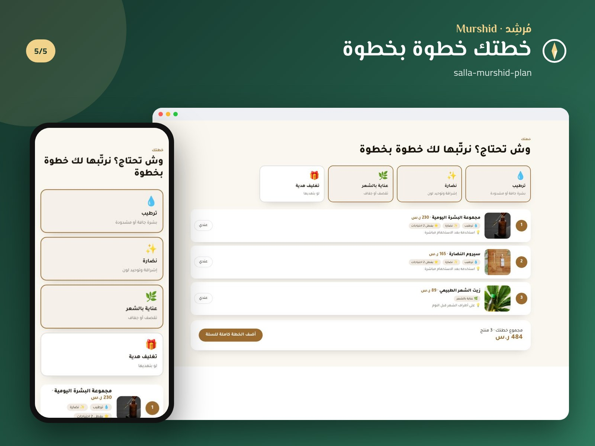

# مُرشِد — مستشار التسوق الذكي
**Murshid — Smart Shopping Advisor** — Twilight Component Bundle لمتاجر سلة (ثيم رائد وأي ثيم يدعم Twilight).

5 مستشارين أذكياء: اختبار يرشّح من منتجاتك ويشرح السبب (ويبني نفسه تلقائياً من أسعار ومبيعات وأقسام متجرك)، محدد هدايا بميزانية وبطاقة إهداء، مساعد محادثة يفهم الميزانية والعروض ويبحث في منتجاتك الفعلية، مستشار مقاس من جدولك، وخطة احتياجات خطوة بخطوة.

5 smart advisors: a quiz that scores your real products and explains why (and builds itself from your prices, sales and categories), a gift finder with budget and gift card, a chat assistant that understands budgets and searches your catalogue, a size advisor from your chart, and a needs-based shopping plan.

| العنصر | الوظيفة | عدد الإعدادات |
|---|---|---|
| `salla-murshid-advisor` | المستشار الذكي | 66 |
| `salla-murshid-gift` | محدد الهدايا | 60 |
| `salla-murshid-chat` | مساعد المحادثة | 57 |
| `salla-murshid-size` | مستشار المقاس | 57 |
| `salla-murshid-plan` | خطتك خطوة بخطوة | 49 |

**مجموع الإعدادات: 289** — تشمل لكل عنصر 30 إعداد تصميم موحد (السمة، الألوان، الخط، المسافات، الحركة، الجدولة، الإخفاء حسب الجهاز، مساعد الإعداد داخل المحرر).

## ذكاء العناصر
- **للتاجر:** إذا تُركت المنتجات فارغة يختار العنصر تلقائياً من بيانات متجرك (الأكثر مبيعاً، الأحدث، العروض…) ويكتب نصوصاً جاهزة بالعربية والإنجليزية، مع مساعد إعداد يظهر داخل المحرر فقط.
- **للعميل:** ذاكرة على جهاز العميل فقط (localStorage) لما شاهده وأضافه، لترتيب الاقتراحات — بدون أي بيانات شخصية تُرسل.
- **بدون أرقام مزيفة:** المخزون والمبيعات والتقييمات والخصومات وتواريخ انتهاء العروض تُقرأ من بيانات سلة الحقيقية فقط، وما لا يتوفر لا يُعرض.

## التطوير
```bash
pnpm install
pnpm run build        # vite build — dist/<component>.js
pnpm run build:split  # كل عنصر في ملف مستقل
```
المعاينة المحلية بالبيانات التجريبية: `demo/index.html` (بيانات عينة فقط).

## صور






